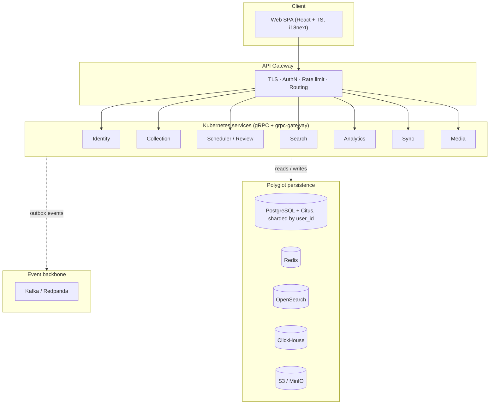

<p align="center">
  
</p>

<h1 align="center">MindMesh</h1>

<p align="center">
  An Anki-like spaced-repetition flashcards platform, built server-authoritative and
  web-only for global scale.
</p>

<p align="center">
  
  
</p>

---

MindMesh is a **greenfield Go microservices monorepo** implementing spaced-repetition
flashcards (notes, cards, decks, FSRS scheduling) at 1M+ user scale. Unlike Anki's
client-owned scheduling, MindMesh is **server-authoritative**: a Go backend is the single
source of truth for FSRS intervals and card state, while clients only submit review grades.
Offline-first is intentionally out of scope — this is a **web-only** platform (React SPA),
with sync solved as a server-driven USN delta feed rather than client-side CRDTs.

The full design lives in [`docs/architecture.md`](docs/architecture.md) (see [Documentation](#documentation)).

## Features

- **Notes, cards & decks** — structured note types, multiple card templates per note,
  nested decks, cloze deletion, image occlusion.
- **Server-authoritative FSRS scheduling** — the Scheduler service owns due dates,
  stability/difficulty, daily limits, queue building, and per-user weight optimization.
- **Full-text & faceted search** — an OpenSearch-backed query DSL for browsing and
  bulk-editing large collections.
- **Analytics** — daily activity, accuracy, and retention stats via ClickHouse.
- **Server-driven sync** — USN-based delta sync, no offline conflict resolution needed.
- **Media handling** — dedup'd image/audio/video/LaTeX storage in S3-compatible object
  storage.
- **Multilingual by design** — i18next on the frontend, locale-aware backend catalogs and
  search analyzers.
- **Contract-first APIs** — protobuf source of truth (`api/`), generating both Go service
  stubs and the OpenAPI spec consumed by the TypeScript client — no hand-drifted clients.

## Architecture



Per-service → per-store detail (which is the part that got tangled above) is precise in the table
below rather than in the diagram.

| Service | Responsibility | Primary store |
|---|---|---|
| **Identity** | Users, profiles, OAuth2/OIDC, JWT, sessions | Postgres + Redis |
| **Collection** | Notes, cards, decks, note types, tags, flags | Postgres (sharded) |
| **Scheduler** | Server-authoritative FSRS, queue, daily limits | Postgres |
| **Media** | Upload/serve images/audio/video, dedupe | S3 + Postgres |
| **Search** | Query DSL, browser listing, faceting | OpenSearch |
| **Analytics** | Daily activity, accuracy, retention | ClickHouse |
| **Sync** | Server-authoritative USN delta sync | Postgres |

Services communicate **gRPC internally**; the gateway exposes **REST/JSON externally** via
grpc-gateway annotations. Cross-service async effects (indexing, analytics, media
processing) flow over **Kafka** through a transactional outbox, keeping request paths fast.

## Stack

Go 1.26 · gRPC + grpc-gateway · [buf](https://buf.build) (proto lint/breaking/codegen) ·
PostgreSQL 18 + Citus · Redis · Kafka/Redpanda · OpenSearch · ClickHouse · S3/MinIO ·
OpenTelemetry/Jaeger + Prometheus/Grafana + ELK · Kubernetes (Helm + ArgoCD) · React + TS +
Vite + i18next (frontend).

## Prerequisites

- Go 1.26+
- Docker (for the local dependency stack)
- Node 22+ (for the `web/` SPA)
- [`task`](https://taskfile.dev) (Taskfile runner)
- Dev-only Go tools: `buf` and the protoc plugins are pinned as `tool` directives in
  `go.mod` (run via `go tool`, nothing to install); `golang-migrate` and `golangci-lint`
  install with `task tools`.

## Getting started

```bash
git clone https://github.com/ai-fn/MindMash.git
cd MindMash

task tools          # install migrate + golangci-lint (buf/protoc plugins run via `go tool`)
task gen            # buf generate: proto -> Go stubs + OpenAPI
task build           # build all service binaries
```

Bring up the local backend stack (Postgres, Redis, Kafka/Redpanda, OpenSearch, ClickHouse,
MinIO, Jaeger, Prometheus, Grafana) and apply migrations:

```bash
task compose-up      # start the full local stack (docker compose)
task migrate         # apply all Postgres migrations (platform first)
task run             # start deps + run the identity service, as an example
```

For the web SPA:

```bash
task web-install
task web-dev         # Vite dev server on :5173, proxies /v1 to the backend
```

> [!TIP]
> For the full kind/Tilt local dev environment (all services on a local Kubernetes cluster
> with hot reload), see [`deploy/README.md`](deploy/README.md) or run `task dev-up && task dev`.

## Usage

Common `task` targets (see `Taskfile.yml` for the full list):

| Command | Description |
|---|---|
| `task gen` | Regenerate Go stubs + OpenAPI from protos |
| `task build` | Build all service binaries |
| `task test` / `task test-short` | Full test suite / unit-only (no testcontainers) |
| `task lint` | `go vet` + `golangci-lint` + `buf lint` |
| `task migrate` | Apply all Postgres migrations, shared `platform` tables first |
| `task compose-up` / `task compose-down` | Start/stop the local dependency stack |
| `task dev-up` / `task dev` / `task dev-down` | Bootstrap and run the full stack on kind + Tilt |
| `task web-dev` / `task web-lint` / `task web-test` / `task web-build` | Frontend dev/lint/test/build |

## Configuration

Local dev configuration is driven by `.env` (copy from [`.env.example`](.env.example)),
consumed by `scripts/cluster-up.sh`, `scripts/cluster-down.sh`, and the `Tiltfile`. Variable
names match the `ExternalSecret` keys used in staging/prod, so the config contract is
identical across environments — only the source (`.env` vs. ExternalSecrets) differs.

## Project structure

```
api/                  # protobuf contracts (source of truth) + buf config
cmd/<service>/        # thin main.go entrypoint per service binary
internal/
  <service>/          # domain, handlers, repositories per service
  platform/           # shared libs: config, log, observability, db, cache, events,
                       # auth, httpx, grpcx, blob, ids, errors, i18n
pkg/                  # reusable libs: fsrs, template, searchdsl
migrations/<store>/   # golang-migrate SQL per store
deploy/               # Helm charts + ArgoCD (kind/Tilt for local, GitOps for prod)
web/                  # React SPA
test/                 # e2e (Playwright), load (k6), contract tests
docs/                 # architecture spec
```

## Documentation

- [`docs/architecture.md`](docs/architecture.md) — system overview, service catalog, data
  model, build order.
- [`functional-requirements.md`](functional-requirements.md) — product requirements.
- [`deploy/README.md`](deploy/README.md) — local (kind/Tilt) and production (Helm/ArgoCD)
  deployment.
- [`CLAUDE.md`](CLAUDE.md) — repository conventions for AI-assisted development.

## Contributing

Bug reports, feature requests, and PRs are welcome. See [`CONTRIBUTING.md`](CONTRIBUTING.md)
for the branching model, code style, and testing expectations before opening a pull request.

## License

MIT — see [`LICENSE`](LICENSE) for the full text.
