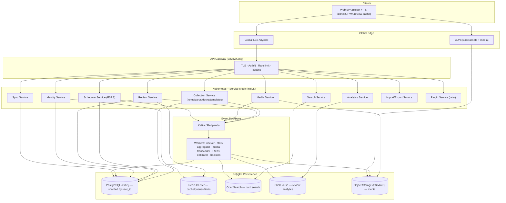

# MindMesh — System Architecture (Anki-like Flashcards Web App)

## Context

We are designing a **greenfield** system architecture for **MindMesh**, an intelligent
spaced-repetition flashcards web application modeled on Anki. This document is the
foundational blueprint that subsequent implementation work follows.

**Confirmed design constraints:**

| Decision | Choice | Consequence |
|---|---|---|
| Client scope | **Web app only** (online) | Server-authoritative model. No native offline-first CRDT/conflict-resolution engine. Optional PWA review-cache only. |
| Scale target | **Global, 1M+ users** | Multi-region, per-user horizontal sharding, aggressive caching, CDN, event-driven analytics. |
| FSRS scheduling | **Server-authoritative** | Backend Go service is the single source of truth for intervals; clients only submit review grades. |
| Stack | **Go backend, Kubernetes, ELK monitoring, caching, polyglot persistence** | Multilingual + fault-tolerant throughout. |
| Deliverable | **Buildable blueprint** | Service catalog, data model, APIs, infra, repo layout, and phased build order. |

The goal: a scalable, fault-tolerant, multilingual platform that implements the full
requirements set (notes/cards/decks, FSRS, media, search, stats, sync, import/export,
plugins) with a clear MVP → Advanced build path.

> **Detailed sub-plans** for each section live under [`docs/detailed/`](./detailed/). This
> file is the index/overview; the detailed files are the per-component implementation specs.

---

## 1. High-Level Architecture



**Architectural style:** domain-oriented **microservices** on Kubernetes, communicating
**gRPC internally** and exposing **REST/JSON externally** (via gateway / gRPC-gateway).
Async cross-service effects (analytics, search indexing, media processing) flow over
**Kafka** to keep request paths fast and services decoupled.

---

## 2. Service Catalog

Each service is an independently deployable Go binary (own DB schema / store ownership).

| Service | Responsibility | Primary store | Detailed spec |
|---|---|---|---|
| **Identity** | Users, profiles, OAuth2/OIDC, JWT, sessions | Postgres + Redis | [01-identity-service.md](./detailed/01-identity-service.md) |
| **Collection** | Notes, cards, decks (nested), note types, tags, flags, bulk ops | Postgres (sharded) | [02-collection-service.md](./detailed/02-collection-service.md) |
| **Scheduler** | Server-authoritative FSRS, card states, daily limits, queue, simulation | Postgres | [03-scheduler-service.md](./detailed/03-scheduler-service.md) |
| **Review** | Review logs, emit `review.recorded` | Postgres → Kafka | [03-scheduler-service.md](./detailed/03-scheduler-service.md) |
| **Media** | Upload/serve images/audio/video/LaTeX, dedupe, occlusion | S3 + Postgres | [04-media-service.md](./detailed/04-media-service.md) |
| **Search** | Advanced query DSL, browser listing, faceting | OpenSearch | [05-search-service.md](./detailed/05-search-service.md) |
| **Analytics** | Daily activity, accuracy, retention, heatmap | ClickHouse | [06-analytics-service.md](./detailed/06-analytics-service.md) |
| **Sync** | Server-authoritative USN delta sync | Postgres | [07-sync-service.md](./detailed/07-sync-service.md) |
| **Import/Export** | CSV/JSON/`.apkg`, shared decks, backups | Postgres + S3 | [08-import-export-service.md](./detailed/08-import-export-service.md) |
| **Plugin** | Plugin registry + sandboxed extension API | Postgres | [09-plugin-and-templates.md](./detailed/09-plugin-and-templates.md) |

> Pragmatic start: implement **Identity, Collection, Scheduler+Review, Media, Search,
> Analytics, Sync** first; Import/Export and Plugin land in later phases.

---

## 3. Data Model (core, Postgres)

Sharded **by `user_id`** (Citus distributed tables) — user data is naturally isolated, so
co-locating a user's notes/cards/decks/reviews on one shard gives single-shard reads for
nearly every query. Full schema + indexes: [10-data-model.md](./detailed/10-data-model.md).
All Postgres services share one database; table ownership and cross-service access rules:
[ADR 0001](./adr/0001-modular-monolith-shared-citus.md). Reads are scoped per user, not per
profile: [ADR 0002](./adr/0002-user-level-data-scoping.md).

```
users(id, email, locale, created_at, ...)
profiles(id, user_id, name)
note_types(id, user_id, name, fields JSONB, card_templates JSONB, css TEXT)
notes(id, user_id, note_type_id, fields JSONB, tags TEXT[], flags SMALLINT, usn, mtime)
cards(id, user_id, note_id, deck_id, template_ord, state, due, stability, difficulty,
      reps, lapses, usn, mtime)
decks(id, user_id, parent_id, name, config_id, usn)
deck_configs(id, user_id, new_per_day, rev_per_day, desired_retention, fsrs_weights REAL[])
filtered_decks(id, user_id, name, query TEXT)
review_logs(id, user_id, card_id, ease, prev_state, prev_ivl, new_ivl, time_ms, ts)
media(id, user_id, checksum, kind, s3_key, bytes)
```

---

## 4. Cross-Cutting Concerns

- **4.1 FSRS scheduling** (server-authoritative, queue build, per-user weight optimization,
  load simulation) → [03-scheduler-service.md](./detailed/03-scheduler-service.md).
- **4.2 Caching** (Redis: queue, daily limits, sessions, hot entities, rate limit) →
  [11-caching-and-data-flows.md](./detailed/11-caching-and-data-flows.md).
- **4.3 Multilingual / global** (i18next, Unicode/RTL/CJK, geo routing) →
  [13-i18n-and-global.md](./detailed/13-i18n-and-global.md).
- **4.4 Card formatting & JS safety** (sandboxed iframe, never server-trusted) →
  [09-plugin-and-templates.md](./detailed/09-plugin-and-templates.md).
- **4.5 Eventing** (Kafka topics, async effects) →
  [11-caching-and-data-flows.md](./detailed/11-caching-and-data-flows.md).

---

## 5. Infrastructure & Operations

- **Kubernetes** (EKS multi-region, HPA, mesh, GitOps) →
  [14-kubernetes-deployment.md](./detailed/14-kubernetes-deployment.md).
- **Observability** (ELK logs + Prometheus/Grafana + OTel/Jaeger) →
  [15-observability-elk.md](./detailed/15-observability-elk.md).
- **Fault tolerance & DR** (multi-AZ, replication, backups) →
  [16-fault-tolerance-and-dr.md](./detailed/16-fault-tolerance-and-dr.md).
- **Security** (OIDC/JWT, mTLS, sandboxing, WAF) →
  [17-security.md](./detailed/17-security.md).

---

## 6. Repository Layout (Go monorepo)

```
mindmesh/
├── api/                  # protobuf/OpenAPI contracts (source of truth)
├── cmd/<service>/        # one main.go per service
├── internal/
│   ├── <service>/        # handlers, domain logic, repositories per service
│   └── platform/         # shared: config, logging, otel, kafka, db, auth middleware
├── pkg/fsrs/             # FSRS scheduling logic
├── migrations/           # SQL migrations
├── deploy/               # helm/kustomize + argocd
├── web/                  # React + TS SPA (Vite, i18next, TanStack Query, Tailwind)
└── docs/                 # this architecture set
```

Full conventions + frontend plan: [12-frontend-web-spa.md](./detailed/12-frontend-web-spa.md)
and [18-repo-and-platform-foundations.md](./detailed/18-repo-and-platform-foundations.md).

**Stack:** Go 1.22+, gRPC + gRPC-gateway, PostgreSQL 16 + Citus, Redis Cluster, OpenSearch,
ClickHouse, Kafka/Redpanda, S3/MinIO, Kubernetes + Istio + ArgoCD, ELK +
Prometheus/Grafana + OpenTelemetry/Jaeger. Frontend: React + TypeScript + Vite + i18next.

---

## 7. Build Order (maps to requirements §13: MVP → Advanced)

Full milestone breakdown: [19-build-roadmap.md](./detailed/19-build-roadmap.md).

- **Phase 0 — Foundations:** monorepo scaffold, `internal/platform`, Helm/ArgoCD skeleton,
  CI, local `docker-compose`.
- **Phase 1 — MVP:** Identity, Collection (basic), Scheduler (simplified), Sync (USN), Web SPA.
- **Phase 2 — Intermediate:** Cloze/reversed, Tags/Flags, Search, Analytics, Media, i18n.
- **Phase 3 — Advanced:** full FSRS + optimization, Image Occlusion, custom templates,
  Filtered Decks, Import/Export, Plugins.
- **Phase 4 — Global hardening:** multi-region, autoscaling, canary, full observability, DR.

---

## 8. Requirements Traceability

| Req (functional-requirements.md) | Component | Detailed spec |
|---|---|---|
| §2–3 Notes/Cards/Decks/types/cloze/occlusion/media/formatting | Collection + Media | 02, 04, 09, 10 |
| §4 States/feedback/FSRS/daily-limits | Scheduler | 03 |
| §5–6 Tags/flags/custom types/search/bulk | Collection + Search | 02, 05 |
| §7 Filtered decks | Collection + Search | 02, 05 |
| §8 Stats | Analytics | 06 |
| §9 Sync (web, online) | Sync | 07 |
| §10 Import/Export & shared decks | Import/Export | 08 |
| §11–12 Plugins/templates/JS/profiles/backups | Plugin + Collection + Identity | 01, 09, 16 |
| §14 Non-functional (100k+ cards, integrity, extensibility) | sharding/caching/eventing | 10, 11, 16 |

> **Offline-first is intentionally descoped** (web-only decision). The USN/Sync design leaves
> a clean seam to add native offline clients later without rearchitecting the data layer.
